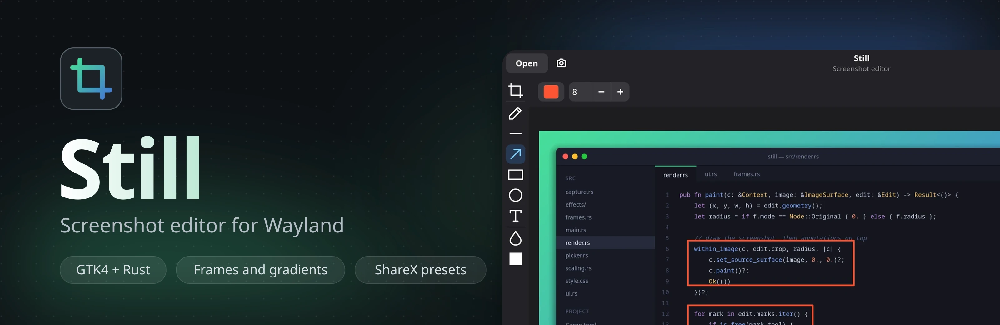
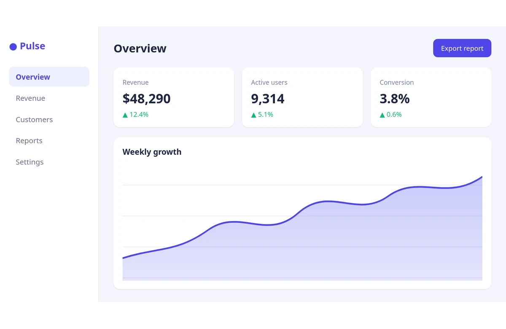
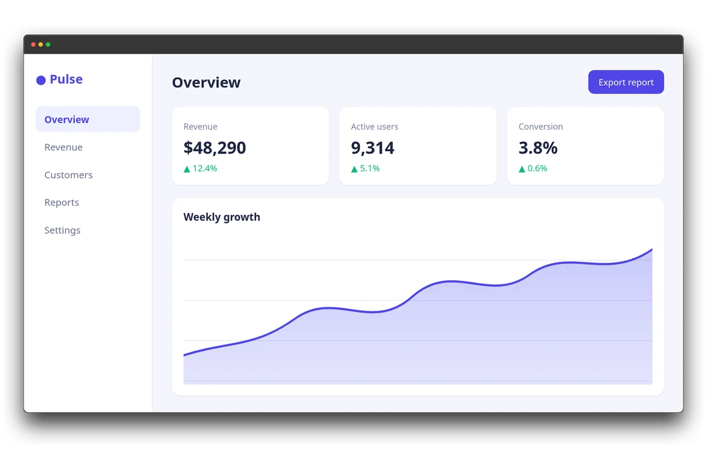
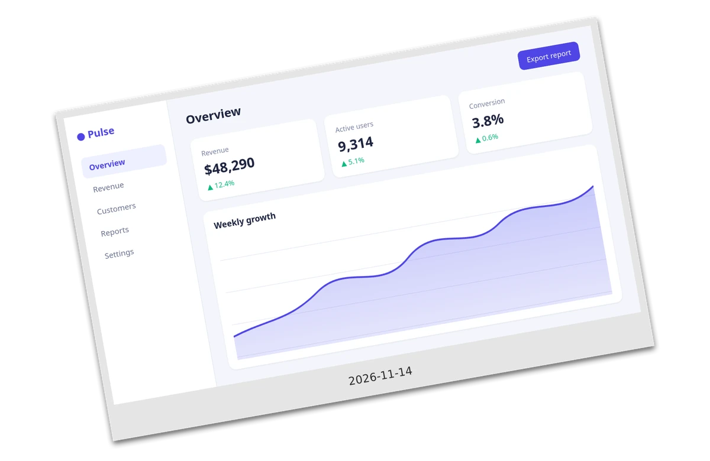
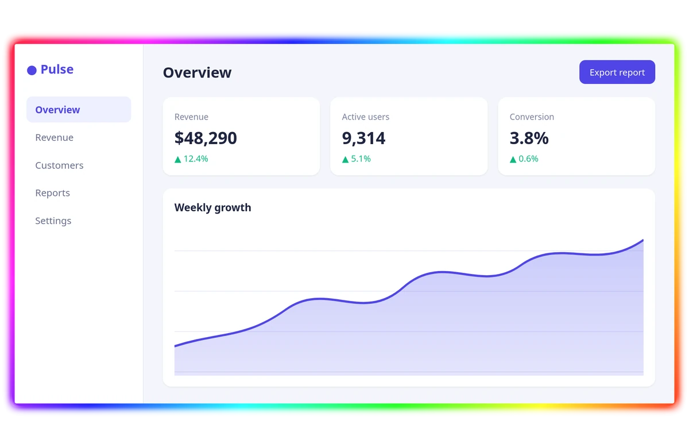
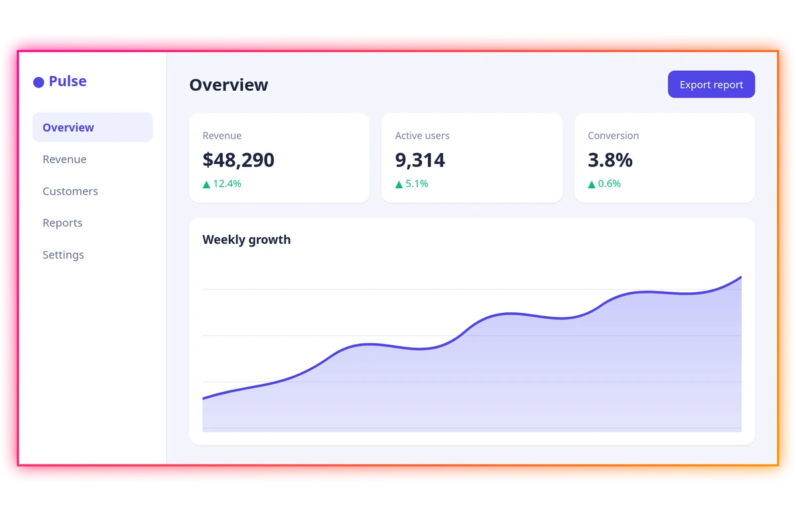
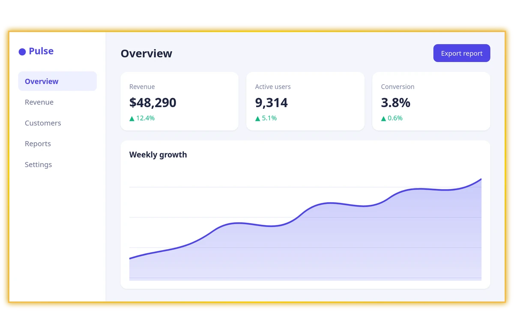
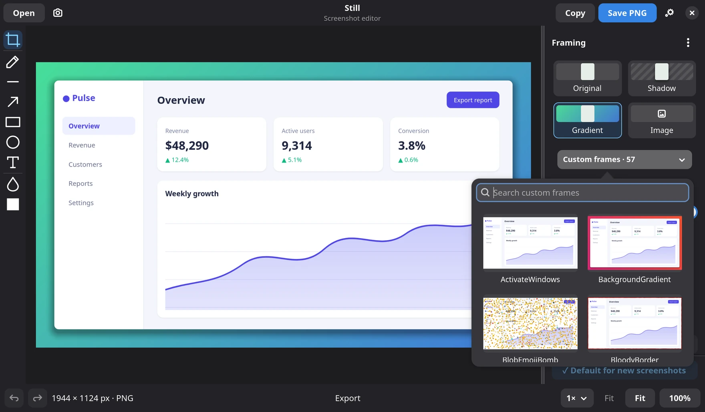
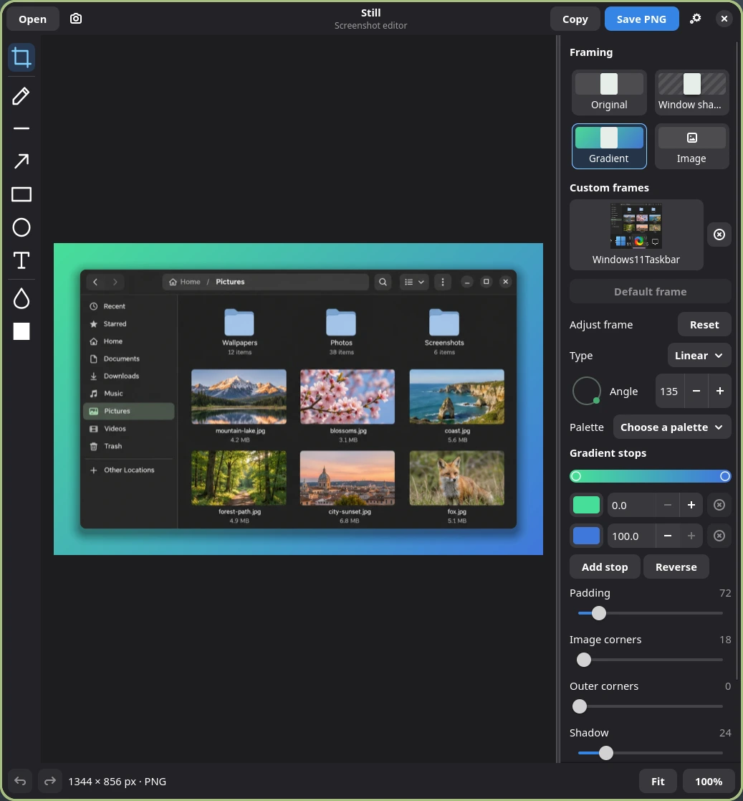
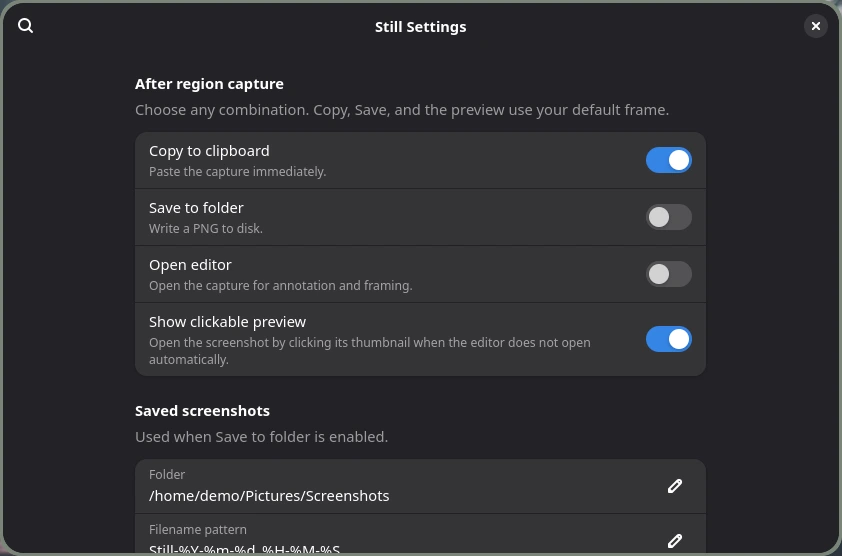

<p align="center">
  
</p>

# Still

Capture a region, paste it straight away, or click its preview to open the editor. Still is a native Linux app built with Rust, GTK4, and libadwaita. It keeps your screenshot at its captured resolution through editing and PNG export.

## ShareX frames

Import a ShareX image effect preset and Still applies it to your screenshots. The same capture is shown below, unframed and through five `.sxie` packages.

<table>
  <tr>
    <td align="center"><br><sub>Original</sub></td>
    <td align="center"><br><sub>macOS Big Sur</sub></td>
    <td align="center"><br><sub>Polaroid</sub></td>
  </tr>
  <tr>
    <td align="center"><br><sub>Neon Rainbow Glow</sub></td>
    <td align="center"><br><sub>Sunset Glow</sub></td>
    <td align="center"><br><sub>Gold Border</sub></td>
  </tr>
</table>

Open a `.sxie` package under **Framing → Import ShareX preset…**. Still keeps a local copy and lists it in the **Custom frames** picker.



## Editor



- **Annotate** with arrows, lines, freehand strokes, rectangles, ellipses, and text. Crop, blur, or cover private details with opaque redaction.
- **Frame** with a transparent window shadow, a gradient, or an image backdrop. Adjust padding, image corners, outer corners, and shadow independently.
- **Edit gradients** with a direction dial, exact angle, palettes, and up to five color stops. Choose linear, radial, or conic.
- **Import ShareX frames and styles.** Open a `.sxie` package under **Framing → Import ShareX preset…**. Still saves a local copy and lists it in the searchable **Custom frames** picker, where each tile previews the preset on your own screenshot. Select, delete, or make an imported preset the default.

ShareX import supports every effect in the [ShareX gallery](https://getsharex.com/image-effects): Canvas, Crop, AutoCrop, RoundedCorners, Rotate, TornEdge, DrawBackground, DrawBorder, DrawCheckerboard, DrawImage, DrawParticles, DrawText, DrawTextEx, Shadow, Glow, Blur, Pixelate, Contrast, and SelectiveColor. Effects run in order, disabled ones are skipped, and an effect Still does not know is reported instead of silently dropped.

## Capture your way



Choose any combination of **Copy to clipboard**, **Save to folder**, **Open editor**, and **Show clickable preview** in Settings. The initial setup copies and shows a notification preview. Your notification daemon handles its placement.

Use **Interface scale** to resize Still, controls included, on high-density or fractionally scaled displays. It applies the moment you save. Set **Editor window** to **Compact** for a smaller fixed-size editor that tiling window managers float instead of tiling.

Select a style in **Framing** and click **Make default** to use it for new images, automatic copy and save, and capture previews. Select **Original** and make it the default to keep captures unframed.

## Linux downloads

Tagged builds publish x86-64 and ARM64 downloads on the [Releases page](https://github.com/dev-737/Still/releases).

| Format | Use |
| --- | --- |
| `.tar.gz` | Extract and run `./bin/still` with the runtime dependencies installed. |
| `.deb` | Install with `sudo apt install ./still_VERSION_ARCH.deb` on Ubuntu 24.04 or compatible newer distributions. |
| `.rpm` | Install with `sudo dnf install ./still-VERSION-1.ARCH.rpm` on compatible Fedora systems. |

The binaries target glibc 2.39 or newer and require GTK 4.12 or newer and libadwaita 1.4 or newer. Each release includes SHA-256 checksums.

To publish a release, commit the version in `Cargo.toml` and `Cargo.lock`, then push a matching tag such as `v0.1.0`. The workflow publishes after both architecture builds pass.

## Build and run

Install Rust, GTK 4.12 or newer, libadwaita 1.4 or newer, and the development files for GTK, libadwaita, Cairo, Pango, and Graphene. Region capture uses `slurp` and `grim`, clipboard export uses `wl-copy`, and clickable previews use `notify-send` with an action-capable notification daemon.

```sh
cargo build --release --locked
./target/release/still
./target/release/still --capture
./target/release/still --last
./target/release/still --settings
```

Run `still screenshot.png` to open an existing image, or `still --last` to reopen the most recent capture if you missed its notification. To capture from a compositor shortcut, bind the absolute path to `still --capture`. For example, after installing the binary to `~/.local/bin/still`, use this in Mango, replacing `YOUR_USER`:

```ini
bind=SUPER+SHIFT,s,spawn,/home/YOUR_USER/.local/bin/still --capture
```

## Keyboard shortcuts

| Shortcut | Action |
| --- | --- |
| Ctrl+O / Ctrl+S / Ctrl+C | Open / Save PNG / Copy PNG |
| Ctrl+Shift+S | Capture a region |
| Ctrl+Z / Ctrl+Shift+Z | Undo / Redo |
| Ctrl+, | Capture settings |
| 0 / 1 | Fit / 100% |
| + / - or Ctrl+scroll | Zoom in / out |
| Space+drag or middle-drag | Pan |
| C, P, L, A, U, O, T, B, R | Crop, freehand, line, arrow, rectangle, ellipse, text, blur, redact when the canvas has focus |

Still stores settings and imported presets under `${XDG_CONFIG_HOME:-$HOME/.config}/still`.
